<div align="center">

# 🏥 CarePoint

**Appointment management for small independent clinics and specialist practices**


</div>

> **Status:** design complete, implementation in progress milestone by
> milestone. Sections describing unimplemented work are marked *planned*.
> Everything runs locally with Docker Compose and fictional seed data — no
> cloud account required.

## Table of contents

1. [The problem](#1-the-problem)
2. [What it does](#2-what-it-does)
3. [User journeys](#3-user-journeys)
4. [Architecture](#4-architecture)
5. [Database design](#5-database-design)
6. [Search, pagination and performance](#6-search-pagination-and-performance)
7. [Security model](#7-security-model)
8. [Media storage](#8-media-storage)
9. [Local development](#9-local-development)
10. [Environment variables](#10-environment-variables)
11. [Testing strategy](#11-testing-strategy)
12. [CI and quality gates](#12-ci-and-quality-gates)
13. [Deployment](#13-deployment)
14. [Troubleshooting](#14-troubleshooting)
15. [Roadmap and known limitations](#15-roadmap-and-known-limitations)
16. [Contributing](#16-contributing)
17. [License and acknowledgements](#17-license-and-acknowledgements)

---

## 1. The problem

Small clinics still run their diaries on phone calls and paper books:

- **Double-booking** when two people touch the schedule at once.
- **No self-service** — every booking or cancellation costs staff time.
- **No visibility** — "how full is next week?" and "what's our no-show
  rate?" require manual counting.
- **Existing tools are hospital-grade**: heavy and expensive for a
  three-doctor practice.

CarePoint is scoped to what a small practice actually runs on — discovery,
availability, booking, cancellation, schedules, a receptionist desk, and
basic reporting — with **correctness (zero double-bookings) and tenant
isolation treated as headline engineering properties, not afterthoughts**.

## 2. What it does

**Core feature set** *(planned)*:

- 🩺 Public doctor discovery with specialty filtering
- 🗓️ Real availability computed from weekly schedules, time-off and bookings
- 👤 Patient accounts: register, log in, book, view, cancel within policy
- 🕐 Doctor schedules: weekly windows + dated time-off
- 🖥️ Receptionist desk: agenda, book-on-behalf, reschedule, status management
- 📊 Clinic reporting: appointment counts, utilization, no-show rate
- 🖼️ Staff-managed media: doctor photos and clinic logos via object storage

**Clinic administrator workspace** *(implemented — `/clinic-admin`)*:

- 🔐 Dedicated admin sign-in, separate from the patient experience; no
  public admin or clinic sign-up
- 📋 Operational overview from live data: today's appointments, last-30-day
  totals, no-show rate, per-doctor utilisation, staff counts, clinic settings
- 👥 Staff management: search/filter the clinic's staff, invite
  receptionists, resend invitations, deactivate and reactivate access
- ✉️ Secure onboarding: single-use, expiring invitation links — staff set
  their own password; admins never see or share one
- 🧾 Audit trail of every staff change, shown as a recent-activity feed

**Receptionist workspace** *(implemented — `/staff/login` and `/staff/[clinicId]/agenda`)*:

- 🔐 Dedicated receptionist sign-in, separate from patient and clinic-admin flows
- 📅 Front-desk agenda for the selected clinic with doctor/status filtering
- 🧾 Walk-in and phone bookings created on behalf of the patient by staff
- 🔁 Reschedule and status transitions for `BOOKED`, `COMPLETED`, `NO_SHOW`, and `CANCELLED`
- 🧭 Role-aware routing: users land in the correct workspace based on their `clinicRoles`

**Doctor workspace** *(implemented — `/doctor/login` and `/doctor/[clinicId]/agenda`)*:

- 🔐 Dedicated doctor sign-in, separate from patient, receptionist and clinic-admin flows
- 📅 Doctor-only agenda for the clinic membership linked to their email and role
- 👥 Access granted only through the clinic's staff onboarding flow; the doctor sees only their assigned clinic workspace
- 🧭 Role-aware routing: doctors land in their clinic agenda instead of the patient dashboard

<div align="center">
  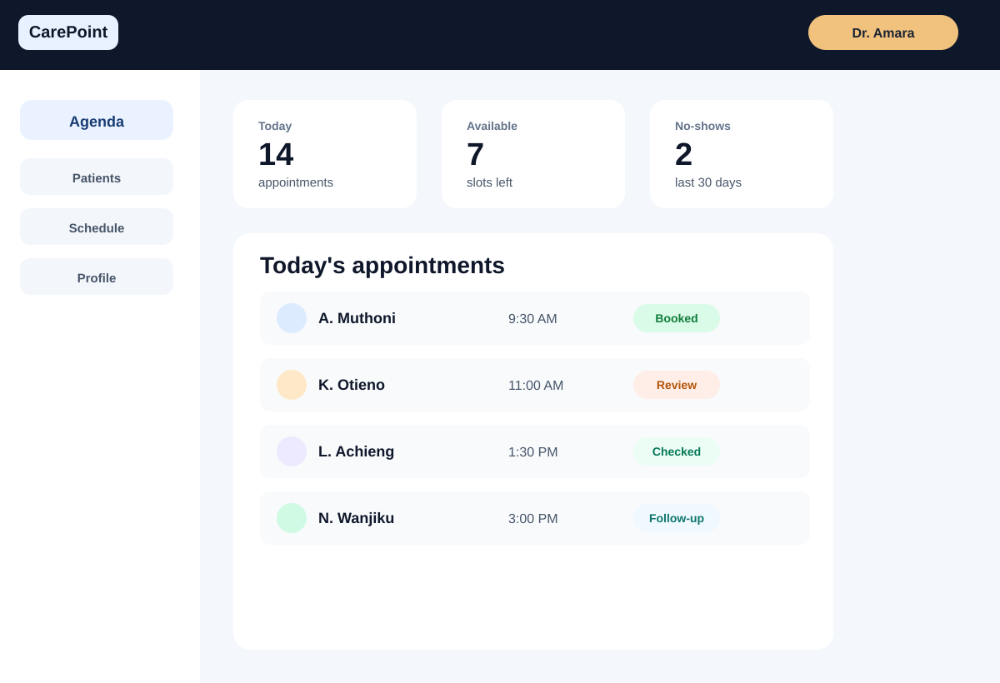
</div>

<sub>Doctor dashboard preview — assigned clinic agenda with appointment summary, patient queue and next-booking views.</sub>

<table>
  <tr>
    <td width="50%">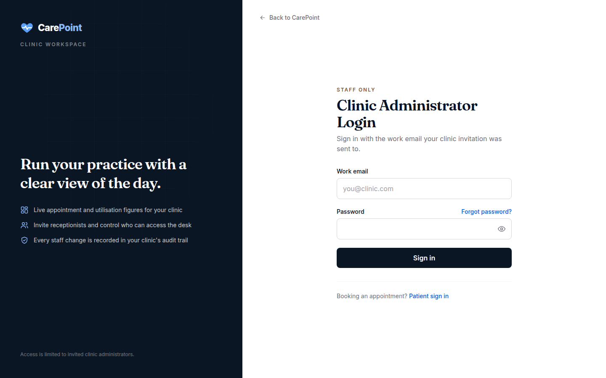</td>
    <td width="50%">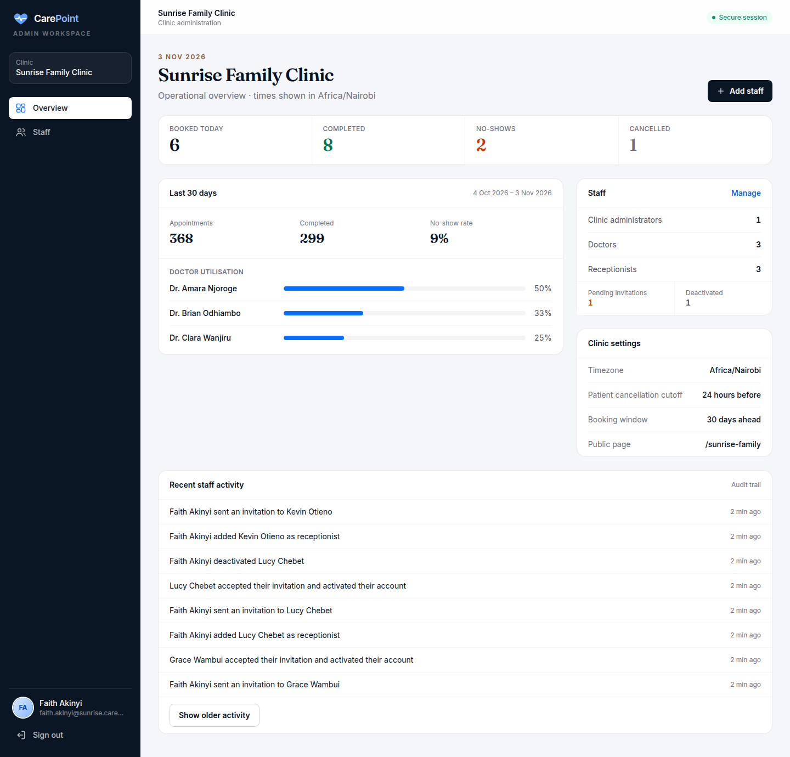</td>
  </tr>
  <tr>
    <td align="center"><sub><b>Clinic Administrator Login</b> — <code>/clinic-admin</code></sub></td>
    <td align="center"><sub><b>Operational overview</b> — <code>/clinic-admin/overview</code></sub></td>
  </tr>
</table>

<sub>Screenshots use fictional seed data from a throwaway demo database.</sub>

**Deliberately out of scope** — *decided, not omitted:*

- Medical records, diagnoses, prescriptions, clinical notes
- Real payments, insurance processing, SMS OTP/MFA
- Video consultations or video upload/transcoding (external embeds only)
- Patient file uploads, waitlists, appointment reminders

## 3. User journeys

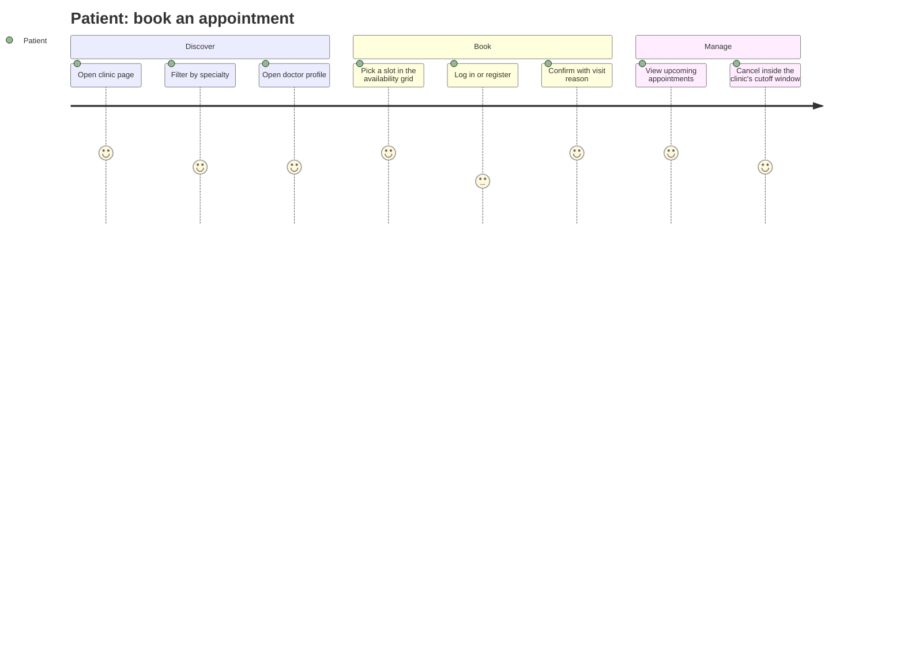

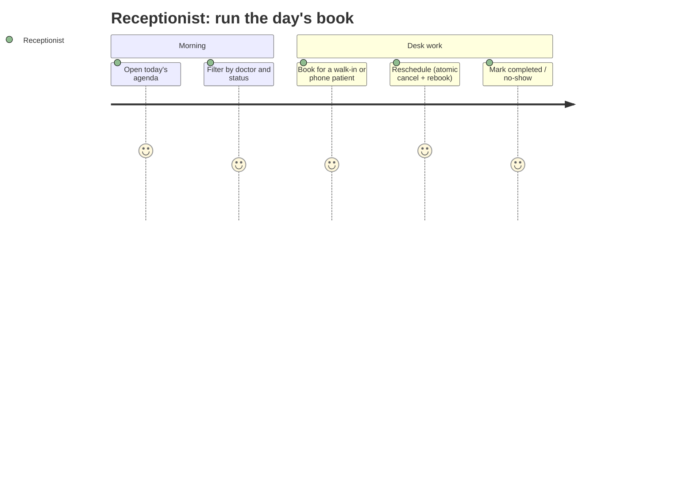

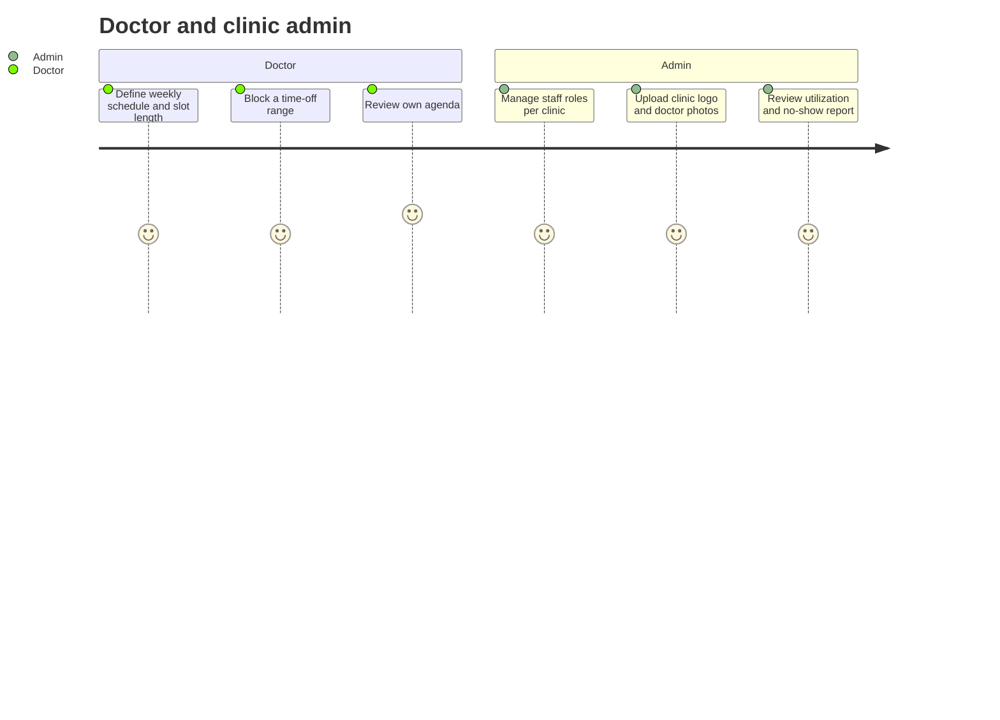

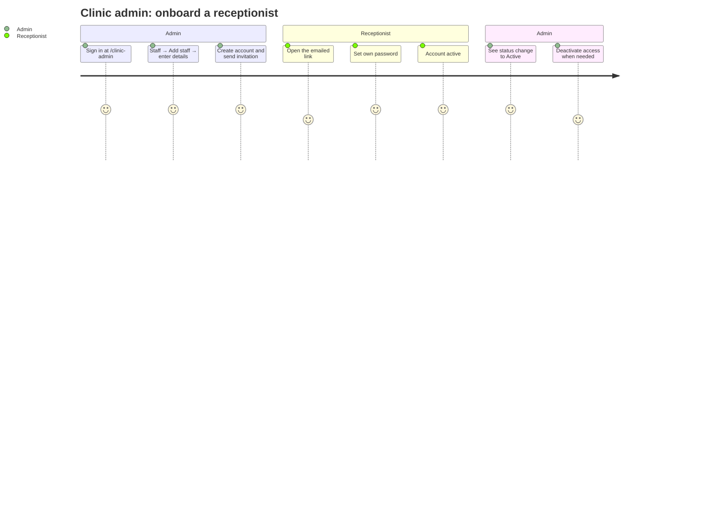

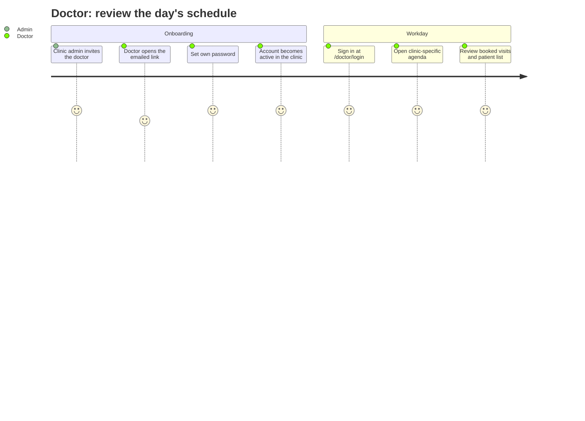

## 4. Architecture

A **modular monolith**: one Spring Boot deployable with enforced internal
module boundaries — the correctness-critical parts (booking, scheduling)
share one transaction boundary, while modules stay cleanly separable.

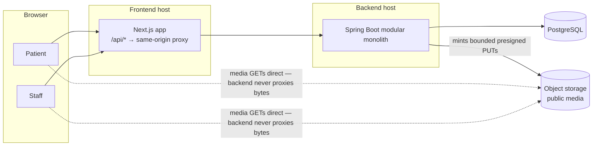

**Module map** (boundaries verified by architecture tests):

| Module | Owns |
| --- | --- |
| `auth` | registration, login, token lifecycle, security config |
| `users` | accounts, clinic memberships, role grants |
| `clinics` | clinic profile, timezone, cancellation policy |
| `catalog` | specialties, doctor profiles, public discovery reads |
| `scheduling` | weekly schedules, time-off, availability engine |
| `booking` | appointment lifecycle, cancellation, desk operations |
| `media` | object metadata, upload authorization pipeline |
| `reporting` | read-only aggregates |
| `common` | error envelope, `Clock`, config, `StorageService` port |

## 5. Database design

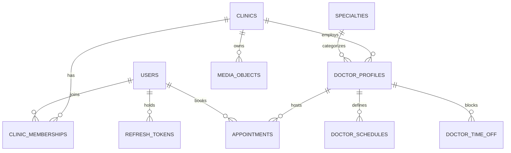

The interesting parts:

- **Double-booking is prevented by the database, not the application.** A
  partial GiST exclusion constraint —
  `EXCLUDE USING gist (doctor_id WITH =, slot WITH &&) WHERE (status='BOOKED')`
  — rejects any overlapping booking inside the insert transaction. Losers get
  `409 SLOT_TAKEN`. Application-level availability checks exist for friendly
  UX; the constraint owns correctness. Reschedules run as cancel + insert in
  a single transaction, so a slot swap is atomic.
- **Tenant isolation is structural.** Every tenant-scoped table carries
  `clinic_id`, and composite foreign keys make cross-clinic references
  *uninsertable* — e.g. an appointment can only reference a
  `doctor_profile` belonging to the same clinic.
- **Indexes are tied to real queries**: GiST `(doctor_id, slot)` for
  availability overlap probes; btree `(clinic_id, lower(slot))` for agenda
  scans; `(patient_id, lower(slot))` for a patient's own history.
- **UTC everywhere** (`timestamptz`); each clinic declares an IANA timezone
  used for schedule math and display.
- Migrations are versioned and forward-only.

## 6. Search, pagination and performance

Measured, not asserted:

- **No unbounded lists** — every collection endpoint paginates (offset
  pagination, stable `ORDER BY …, id` tiebreak, enforced max page sizes).
- **Slim projections** — list endpoints return card-level DTOs, never full
  entities; a fixed **query budget per endpoint** is asserted in tests so
  N+1 regressions fail CI.
- **Availability** is computed (schedule − time-off − booked), not stored —
  no second source of truth for "what's free". The overlap probe rides the
  GiST range index.
- **Caching is conservative**: short HTTP caching on public reads only;
  operational views (agenda, my appointments) are always fresh; the booking
  path never trusts cached availability.
- **Evidence rule**: index or query changes ship with `EXPLAIN ANALYZE`
  output against a large seeded dataset; load numbers are recorded with the
  environment they were measured on — local figures are never quoted as
  production SLOs.
- Cursor pagination and full-text search are documented as *future*
  options with explicit adoption thresholds — not premature additions.

## 7. Security model

- **Auth**: short-lived access tokens + rotating refresh tokens with
  reuse detection (stolen-token replay revokes the whole family); sessions
  delivered as `HttpOnly; Secure; SameSite=Lax` cookies through a
  same-origin proxy. Passwords hashed with Argon2id.
- **Authorization is server-side only.** Staff endpoints require a
  membership matching the `clinicId` in the path — cross-tenant access
  returns `404`, so existence isn't leaked. Patients can only touch their
  own rows. Privileged roles are granted exclusively through admin
  endpoints; the registration payload has no role field to abuse. There is
  no public endpoint that creates clinics — tenants and their first
  administrator are provisioned server-side.
- **Admin portal sign-in** (`POST /auth/clinic-admin/login`) issues a
  session only to an active `CLINIC_ADMIN` of an active clinic; patients,
  receptionists, doctors, deactivated admins and suspended clinics are
  refused without any cookies being set. Signing in revokes the previous
  session. Roles are re-read from the database on every request, so a
  deactivation takes effect immediately.
- **Rate limiting**: tight limits on login/register (credential stuffing),
  booking (slot hoarding), availability (scraping) and uploads.
- **Hygiene**: parameterized queries only; Bean Validation at every API
  boundary; a stable error-code envelope (`SLOT_TAKEN`,
  `CANCELLATION_WINDOW_PASSED`, `RATE_LIMITED`, …) with no stack leakage;
  structured logs carrying IDs, never tokens, bodies or free text.
- **Audit**: staff operations (added, invitation sent/accepted, role and
  status changes, admin provisioning) write append-only `audit_events`
  in the same transaction as the change. Appointments record `created_by`
  and `cancelled_at`; writing appointment mutations to `audit_events` is
  *planned*.
- **Honest boundary**: this is a portfolio/demo system running on
  fictional data. It does **not** claim HIPAA, GDPR, or any other
  healthcare-regulation compliance — that requires a formal assessment
  before real patient data is ever involved.

### Staff onboarding

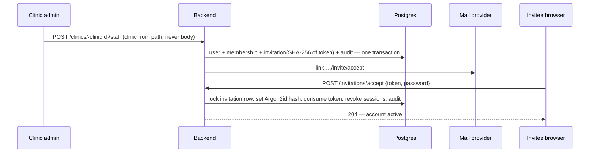

- The raw token exists only in the email; the database stores its hash.
  It rides in the URL **fragment**, so it never reaches server or proxy
  logs, and the page strips it from browser history on load.
- Links are single-use (row lock on accept), expire after 72 h, are revoked
  when re-sent, and stop working if the member is deactivated first.
- Invite and accept endpoints are rate-limited; error messages are uniform
  so a token can't be probed for validity.

### Doctor onboarding

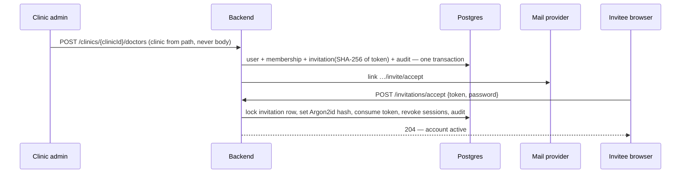

- Same as staff, but targets the `DOCTOR` role.
- Doctors land in their agenda after activation, no separate login flow.

## 8. Media storage

Bytes live in object storage (Cloudflare R2, S3-compatible); PostgreSQL
stores only object keys and metadata.

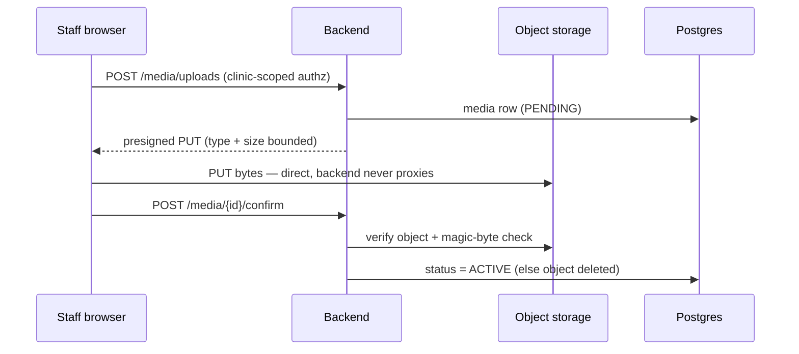

- A small `StorageService` abstraction keeps the app provider-independent;
  a local-disk implementation powers dev/test so **no cloud account is
  needed to run or demo the project**.
- Public media (photos, logos) uses a public bucket with immutable,
  server-generated keys; any future private files would live in a separate
  bucket behind short-lived presigned URLs.
- Uploads are allow-listed image types, size-capped, magic-byte verified,
  and orphaned uploads are reaped automatically.
- Storage credentials exist only on the server. Demo imagery is fictional.

## 9. Local development

**Prerequisites:** Docker + Docker Compose · JDK 21 · Node 20+

```bash
git clone <repo> && cd carepoint-clinic-management
cp .env.example .env                                     # fill in local values
docker compose -f deploy/docker-compose.yml up -d postgres

cd backend
./mvnw spring-boot:run                                   # API on :8080, schema only
./mvnw spring-boot:run -Dspring-boot.run.profiles=seed   # + fictional seed data
```

The `seed` profile additionally applies `db/seed` — a repeatable Flyway
migration creating 2 fictional clinics, 6 doctors, schedules, a demo
patient, a guest patient and media-object rows. Without the profile only
schema migrations run. A ~90 k-appointment synthetic dataset for query
measurement lives in `db/perf/seed_perf.sql` and is loaded on demand via
psql — never automatically.

Media works fully offline — `STORAGE_PROVIDER=local` writes to a local
directory; switching to R2 is an env-var change, not a code change.

### Clinic administrator access

The clinic workspace lives at `/clinic-admin`. There is no public admin
or clinic sign-up: the first administrator is provisioned server-side and
activates through a single-use invitation link.

**1. Provision the first admin** (backend, from `backend/`):

```bash
./mvnw spring-boot:run -Dspring-boot.run.profiles=seed \
  -Dspring-boot.run.arguments="--carepoint.mail.provider=log \
--carepoint.bootstrap.admin-email=faith.akinyi@sunrise.carepoint.test \
'--carepoint.bootstrap.admin-name=Faith Akinyi' \
--carepoint.bootstrap.clinic-slug=sunrise-family"
```

- Targets an existing clinic by slug, or creates one when given
  `--carepoint.bootstrap.clinic-name=…` and `--carepoint.bootstrap.clinic-timezone=…`
  (IANA, e.g. `Africa/Nairobi`).
- With `mail.provider=log` the invitation email — including its link — is
  printed to the backend console; with `smtp` it is actually sent.
- Idempotent: `INVITED` → `INVITATION_PENDING` → `ALREADY_ACTIVE`. It never
  takes a password from configuration.
- Command-line arguments are used because the app loads `.env` as JVM
  system properties, which take precedence over shell variables — an
  empty `BOOTSTRAP_ADMIN_EMAIL=` line in `.env` would silently win over
  `BOOTSTRAP_ADMIN_EMAIL=… ./mvnw …`. Setting the `BOOTSTRAP_*` values in
  `.env` itself also works.

**2. Activate and sign in** (frontend running via `npm run dev`): open the
invitation link, choose a password, then sign in at
`http://localhost:3000/clinic-admin`.

**3. Navigate the workspace:**

| Route | Purpose |
| --- | --- |
| `/clinic-admin` | Clinic Administrator Login (password visibility toggle, forgot-password, link back to the public site) |
| `/clinic-admin/overview` | Today's appointments, last 30 days, doctor utilisation, staff summary, clinic settings, recent staff activity |
| `/clinic-admin/staff` | Staff directory — search, role/status filters, pagination; table on desktop, cards on mobile |
| `/clinic-admin/staff/new` | Invite a receptionist (name, work email, optional phone; clinic is fixed to the one you manage) |
| `/clinic-admin/staff/[membershipId]` | Staff details, invitation status, resend invitation, deactivate / reactivate |
| `/staff/login` | Receptionist Login — staff-only entry point, no admin navigation on the page |
| `/staff/[clinicId]/agenda` | Front desk agenda — today’s appointments, filters, booking on behalf, status transitions |
| `/invite/accept#token=…` | Invitee sets their password — the only way staff accounts are activated |

The sidebar collapses to a menu below 1024 px. Sessions end after the
idle timeout, and an admin who administers several clinics gets a clinic
switcher.

**API used by the workspace** (all under `/api/v1`, all clinic-scoped
endpoints authorised server-side against the caller's membership):

| Method & path | Who | Notes |
| --- | --- | --- |
| `POST /auth/clinic-admin/login` | public, rate-limited | session only for an active `CLINIC_ADMIN` |
| `GET /clinics/{id}/admin/overview` | `CLINIC_ADMIN` | clinic info + staff aggregates |
| `GET /clinics/{id}/admin/activity?page&size` | `CLINIC_ADMIN` | audit feed, max 50 per page |
| `GET /clinics/{id}/reports/summary?from&to` | `CLINIC_ADMIN`, `RECEPTIONIST` | appointment and utilisation figures |
| `GET /clinics/{id}/staff?q&role&status&page&size` | `CLINIC_ADMIN`, `RECEPTIONIST` | paginated, single-query listing |
| `GET /clinics/{id}/staff/{membershipId}` | `CLINIC_ADMIN` | staff details |
| `POST /clinics/{id}/staff` | `CLINIC_ADMIN`, rate-limited | create account + send invitation |
| `POST /clinics/{id}/staff/{membershipId}/invitation` | `CLINIC_ADMIN`, rate-limited | resend (revokes the old link) |
| `PATCH /clinics/{id}/staff/{membershipId}` | `CLINIC_ADMIN` | `status` ACTIVE/DISABLED (and `role`); never your own; never the last admin |
| `POST /invitations/preview` · `POST /invitations/accept` | public, rate-limited | token in the body only |

The Postman collection in `postman/` has ready-made requests for all of
these under **Clinic admin workspace** and **Staff invitations (public)**.

### Doctor-specific API

| Method & path | Who | Notes |
| --- | --- | --- |
| `POST /auth/doctor/login` | public, rate-limited | session only for an active `DOCTOR` |
| `GET /clinics/{id}/doctor/agenda` | `DOCTOR` | clinic-specific agenda |
| `GET /clinics/{id}/doctor/visits` | `DOCTOR` | today's visits and patient list |

## 10. Environment variables

| Variable | Purpose | Example |
| --- | --- | --- |
| `DB_URL` / `DB_USER` / `DB_PASSWORD` | Postgres connection | `jdbc:postgresql://localhost:5434/carepoint` |
| `DB_POOL_MAX` | connection-pool ceiling | `10` |
| `JWT_SIGNING_KEY` | token signing secret | `change-me-32+-chars` |
| `CORS_ALLOWED_ORIGINS` | explicit origin allow-list | `http://localhost:3000` |
| `STORAGE_PROVIDER` | `local` or `r2` | `local` |
| `R2_*` | bucket, keys, public base URL — **server only** | `<from provider>` |
| `LOCAL_STORAGE_DIR` | dev media root | `./var/media` |
| `SPRING_PROFILES_ACTIVE` | `local` / `ci` / `staging` / `prod` | `local` |
| `FRONTEND_BASE_URL` | origin used in invitation links | `http://localhost:3000` |
| `STAFF_INVITATION_TTL` | staff invitation lifetime | `72h` |
| `BOOTSTRAP_ADMIN_EMAIL` / `BOOTSTRAP_CLINIC_*` | one-time first-admin provisioning — **server only** | *(unset)* |

`.env` is gitignored; `.env.example` carries names and placeholders only.
No real credentials are ever committed.

## 11. Testing strategy

| Layer | Tooling | Proves |
| --- | --- | --- |
| Unit | JUnit 5 | slot math, cutoff rules, status transitions |
| Integration | Testcontainers — **real Postgres, real migrations, no DB mocks** | constraints, transactions, JPA mappings |
| Authorization | parameterized API matrix — every role × endpoint × clinic | cross-tenant access is impossible |
| Concurrency | multi-threaded booking test | N simultaneous bookings → **exactly one** succeeds |
| Architecture | ArchUnit | module boundaries hold |
| Query budget | statement counters | N+1 regressions fail CI |
| Upload security | integration tests | spoofed MIME, oversize, orphan cleanup |
| Frontend | Vitest + Testing Library | forms, guards, error/empty/loading states |
| Accessibility | axe-core in E2E | WCAG 2.1 AA on patient flows |
| E2E | Playwright | full book / cancel / desk flows |
| Performance | k6 + `EXPLAIN ANALYZE` + Lighthouse CI | evidence, not claims |

## 12. CI and quality gates

GitHub Actions, all required before merge:

- **Backend** — compile, full test suite (Testcontainers incl. the
  concurrency test), migration run on ephemeral Postgres
- **Frontend** — lint, typecheck, tests, production build, bundle-size
  report, Lighthouse CI on key flows
- **Security** — dependency review, vulnerability scan, secret scan
- **E2E** — containerized stack + Playwright

`main` is protected: PRs only, green checks required, no direct pushes.
Conventional Commits; one issue → one branch → one PR.

## 13. Deployment

Designed to run a full demo at **$0/month** on current free tiers — and to
run entirely locally via Docker Compose as a permanent fallback:

| Layer | Approach | Note |
| --- | --- | --- |
| Frontend | Vercel free tier | `/api/*` rewrite proxies to the backend |
| Backend | Render free container | sleeps when idle — first request may take ~a minute |
| Database | Neon free Postgres | scales to zero; resumes in <1 s |
| Media | Cloudflare R2 free tier | 10 GB + free egress |

Free tiers are for demonstration only — they sleep, pause, and carry no
durability guarantees. Any real deployment gets its own hardened
configuration review first.

## 14. Troubleshooting

| Symptom | Likely cause |
| --- | --- |
| First request takes ~1 min | Free-tier cold start — expected |
| `extension "btree_gist" does not exist` | migrations didn't run — check Flyway history |
| `409 SLOT_TAKEN` on a visibly free slot | constraint is authoritative — inspect `appointments` for overlapping BOOKED rows |
| Uploads fail locally | `STORAGE_PROVIDER` should be `local` |
| `FATAL: too many connections` | `DB_POOL_MAX` above the DB provider's limit |
| Availability wrong around DST | clinic timezone misconfigured — slots compute in clinic-local time |
| Bootstrap env vars seem ignored | `.env` entries (even empty ones) override shell variables — pass `--carepoint.bootstrap.*` via `-Dspring-boot.run.arguments` or set them in `.env` |
| Bootstrap logs `INVITATION_PENDING` but no link | an unused link was already issued — sign in as another admin and use **Resend invitation**, or wait for it to expire (72 h) and restart |
| "Invitation unavailable" on the accept page | link already used, expired, re-sent, or the member was deactivated — ask an admin to resend |
| Clinic admin login says "does not have clinic administrator access" | account is a patient/receptionist/doctor, the admin membership is deactivated, or the clinic is suspended |

## 15. Roadmap and known limitations

**Delivered:** scaffold + CI (M0) · core schema, fictional seed and the
concurrency test harness (M1) · clinic administrator workspace — portal
sign-in, staff directory, receptionist invitations, access control and
staff audit trail. **Implemented:** receptionist sign-in and desk UI on top of the
admin foundation; role-aware redirects for `CLINIC_ADMIN`, `RECEPTIONIST`, and
patient users; clinic-scoped agenda, booking-on-behalf and status updates.
Small PRs, each with acceptance criteria and tests.

**Known limitations (deliberate):**

- Demo hosting sleeps/pauses — a free-tier reality, not a bug.
- Single-region, single-instance; rate limits are per-instance.
- Reports are aggregates only; no data export.
- The admin UI invites receptionists only; doctor onboarding, role changes,
  clinic-settings editing and logo uploads exist at the API level or are
  planned, not yet in the workspace UI.
- Inviting an email that already has a CarePoint account grants the staff
  role immediately; accepting the invitation (re)sets that account's
  password — equivalent to a password reset by the inbox owner.
- Tenant isolation is enforced in schema + service + tests; Postgres
  row-level security is a documented upgrade path.
- Fictional data only; not assessed or certified for real patient data.

## 16. Contributing

This is currently a solo portfolio project. Conventions: Conventional
Commits, small reviewable PRs, tests required for behavior changes, and
**never commit secrets or real patient data**.

## 17. License and acknowledgements

- License: TBD — will be decided before any public distribution.
- All names, photos, logos and data in the demo are **fictional**.
- Built with Spring Boot, Next.js, PostgreSQL, Cloudflare R2, and a lot of
  respect for database constraints.
